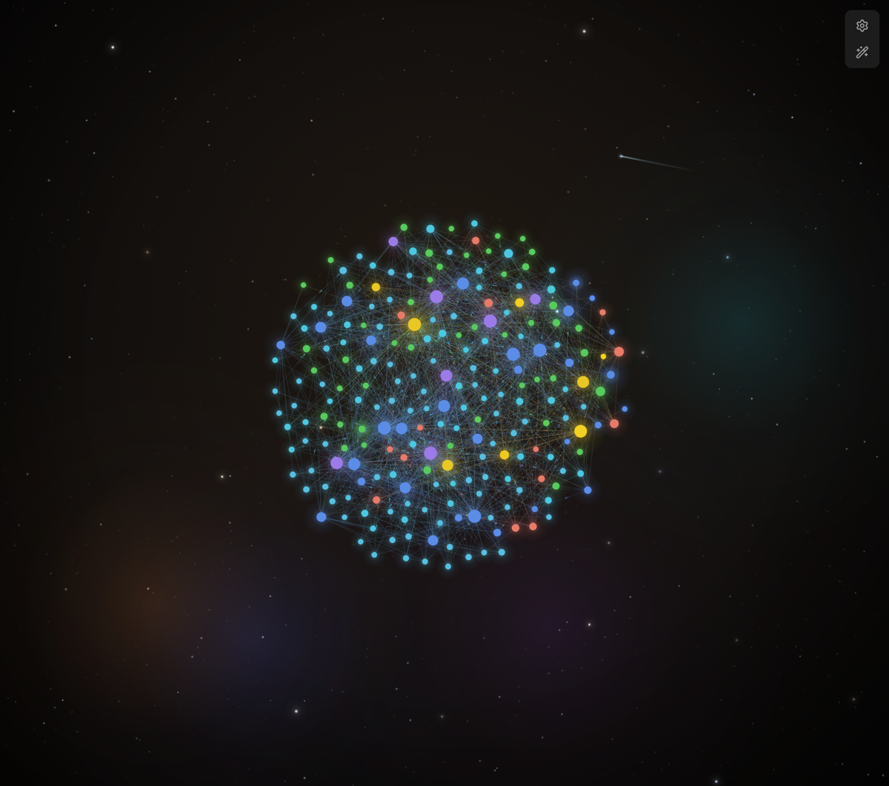

# Graph Sparks

**Turns Obsidian's core graph view into a small piece of deep space.**
Your notes glow, tiny sparks travel between them along real links, and far behind the graph
stars twinkle, nebulae drift and, once in a while, a comet passes by.

[Русская версия ниже ↓](#русский)

## What it does

| Effect | Details |
|---|---|
| **Sparks** | About a quarter of the notes quietly send tiny dots of their own colour along their links to neighbours. The set of "emitting" notes changes every 20 s. Hover or drag a note and it starts sending sparks too. |
| **Glow** | Every node gets a soft halo in its colour. Hubs (25+ links) gently breathe and flash when they send a spark. |
| **Coloured links** | Each link takes the mixed colour of the two notes it connects, so clusters are visible from afar. Hover highlight stays Obsidian's own. |
| **Deep space** | Three layers of stars (700 far, 130 mid, 16 bright with halos) with parallax, dark vignette, and soft nebulae that live in graph space around the ball. |
| **Rare sky events** | Shooting stars (every 35–100 s), star flares (80–180 s), comets (4–8 min) and meteor showers (7–12 min). They fly behind the graph; about a third may pass behind the ball itself. |
| **Balanced node sizes** | Obsidian makes every note with few links equally tiny. Graph Sparks uses a softer scale: small notes are easier to see, hubs are still the biggest. |
| **Works out of the box** | Notes without a colour group get a colour by their top folder. On first run, comfortable graph forces and sizes are set once; change them freely afterwards. |

Everything is drawn on top of Obsidian's own graph renderer: search, filters, groups, forces,
local graph and clicking notes all keep working. Disable the plugin and the graph is back to normal.

## Install

### Manually
1. Download `main.js`, `manifest.json` and `styles.css` from the [latest release](../../releases/latest).
2. Put them into `<your vault>/.obsidian/plugins/graph-sparks/`.
3. Obsidian → **Settings → Community plugins** → turn off Restricted mode if needed → **Reload** → enable **Graph Sparks**.
4. Open the graph (`Ctrl/Cmd + G`).

### With BRAT
Add `TheBeStNakee/obsidian-graph-sparks` in the [BRAT](https://github.com/TfTHacker/obsidian42-brat) plugin.

## Settings
**Settings → Graph Sparks** lets you switch every effect on or off and tune it, live, without reloading:

- **Sparks:** on/off, share of notes that send them, speed, size
- **Glow:** on/off, brightness, breathing hubs
- **Links and nodes:** coloured links and their strength, balanced node sizes, colour by folder
- **Space:** stars and their density, nebulae and their brightness, rare sky events, how often they happen, how many pass behind the graph
- **Graph:** one-click recommended graph settings, reset plugin settings

The settings tab is in Russian or English, following Obsidian's language.

## Tips
- Set your own colour groups in the graph settings (gear icon → Groups): sparks, halos and links follow them.
- When the graph tab is hidden, the animation stops, so it costs nothing in the background.

## Notes
- Desktop and mobile. Tested on Obsidian 1.15.
- The plugin hooks into the internal graph renderer (PIXI). A big Obsidian update may change it; if effects disappear, open an issue.

---

## Русский

**Превращает граф Obsidian в кусочек далёкого космоса.** Заметки светятся, по настоящим связям
между ними бегут крошечные огоньки, а позади графа мерцают звёзды, плывут туманности и иногда пролетает комета.

### Что делает
- **Огоньки:** примерно четверть заметок сама пускает крошечные точки своего цвета по связям к соседям; какие именно — меняется каждые 20 с. Наведи курсор или потяни заметку — она тоже начнёт пускать огоньки.
- **Свечение:** у каждого шарика мягкий ореол его цвета; хабы (25+ связей) «дышат» и вспыхивают, когда выпускают огонёк.
- **Цветные связи:** линия окрашена в смесь цветов двух заметок, кластеры видны издалека.
- **Космос:** три слоя звёзд с параллаксом, виньетка и мягкие туманности вокруг графа (двигаются вместе с ним).
- **Редкие события:** падающие звёзды, вспышки звёзд, кометы и звездопад — позади графа.
- **Ровные размеры:** заметки с малым числом связей не превращаются в точки, хабы всё равно крупнее всех.
- **Работает сразу:** заметки без цветовой группы окрашиваются по своей папке; при первом включении один раз ставятся удобные настройки графа.

### Установка
1. Скачай `main.js`, `manifest.json`, `styles.css` из [последнего релиза](../../releases/latest).
2. Положи в `<хранилище>/.obsidian/plugins/graph-sparks/`.
3. Obsidian → **Настройки → Сторонние плагины** → выключи безопасный режим → **Обновить** → включи **Graph Sparks**.
4. Открой граф (`Ctrl + G`).

**Настройки → Graph Sparks:** каждый эффект включается и выключается отдельно, есть ползунки силы, плотности и частоты; кнопки «рекомендуемые настройки графа» и «сбросить». Всё применяется сразу. Выключишь плагин — граф станет обычным.

## License
MIT
